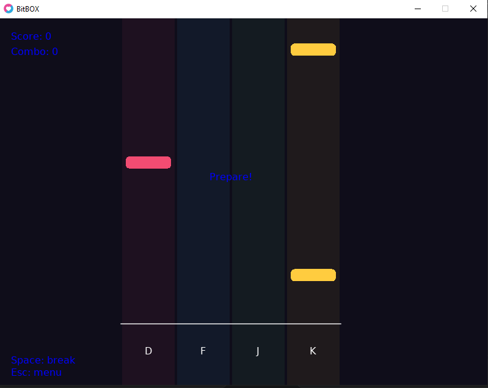
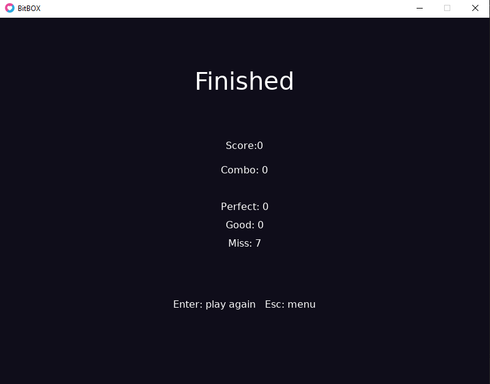
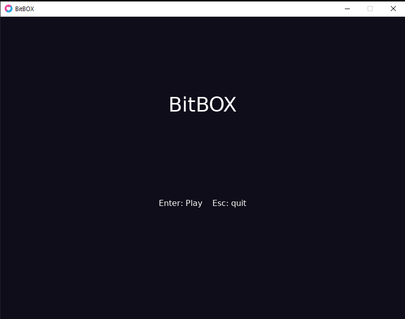

# BitBOX

**BitBOX** is a rhyming game composed of 4 tracks, made in Lua, which, by the way, is a programming language made by Brazilians. I used LOVE. Press the key when the note reaches the line.





# How to play

1. Install LOVE
2. Download the project, or clone the repository
3. Open the terminal in the project folder and run

```bash
love .

```

On Windows, you can also drag the folder onto ```love.exe```. Or, in the release here in the repository, there's an .exe file to download; install it and play.

# Controls

| Key | Action |
| :--- | :--- | 
| D, F, J, K | Match the notes |
| Enter | Start or play again |
| Space | Pause or continue |
| Esc | Return to menu on the score or result, exit from menu |